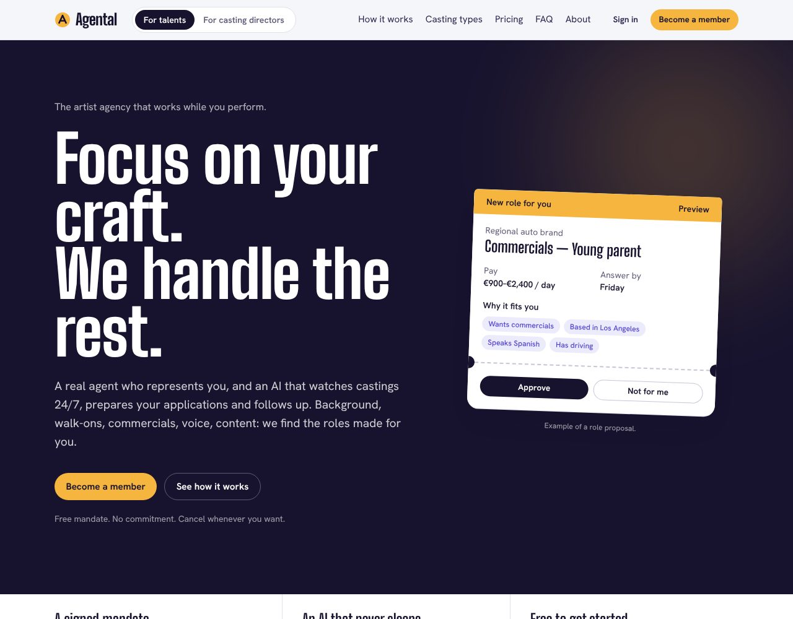
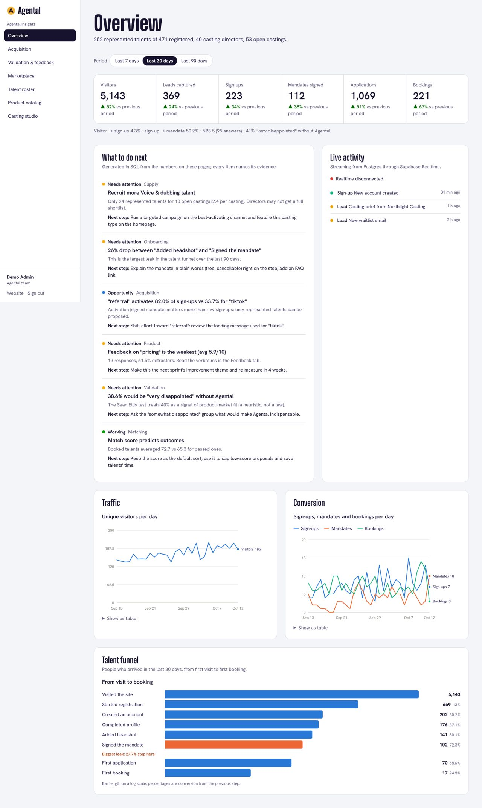
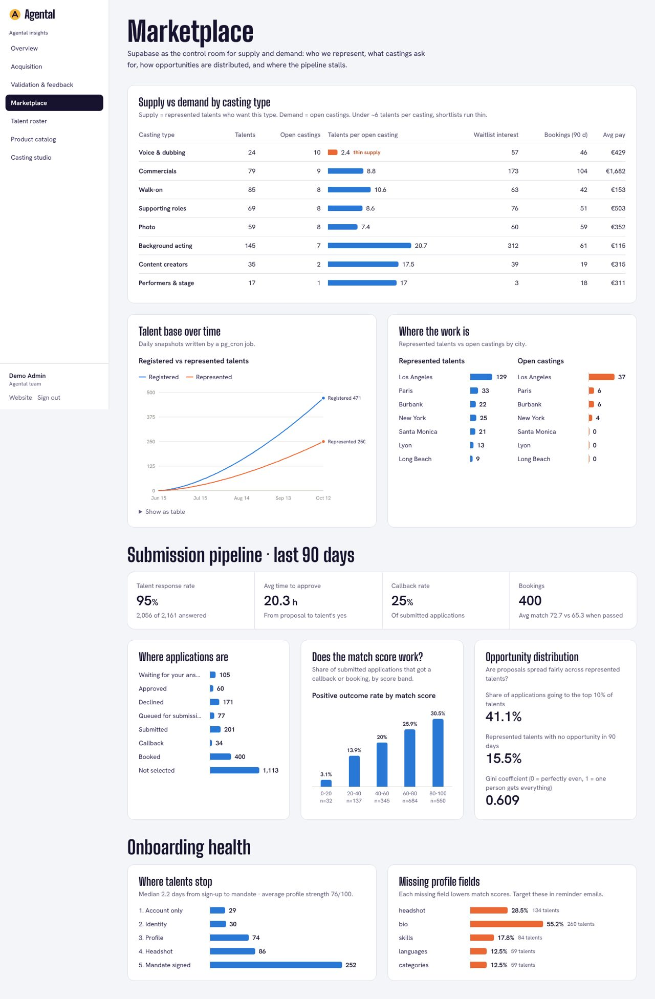
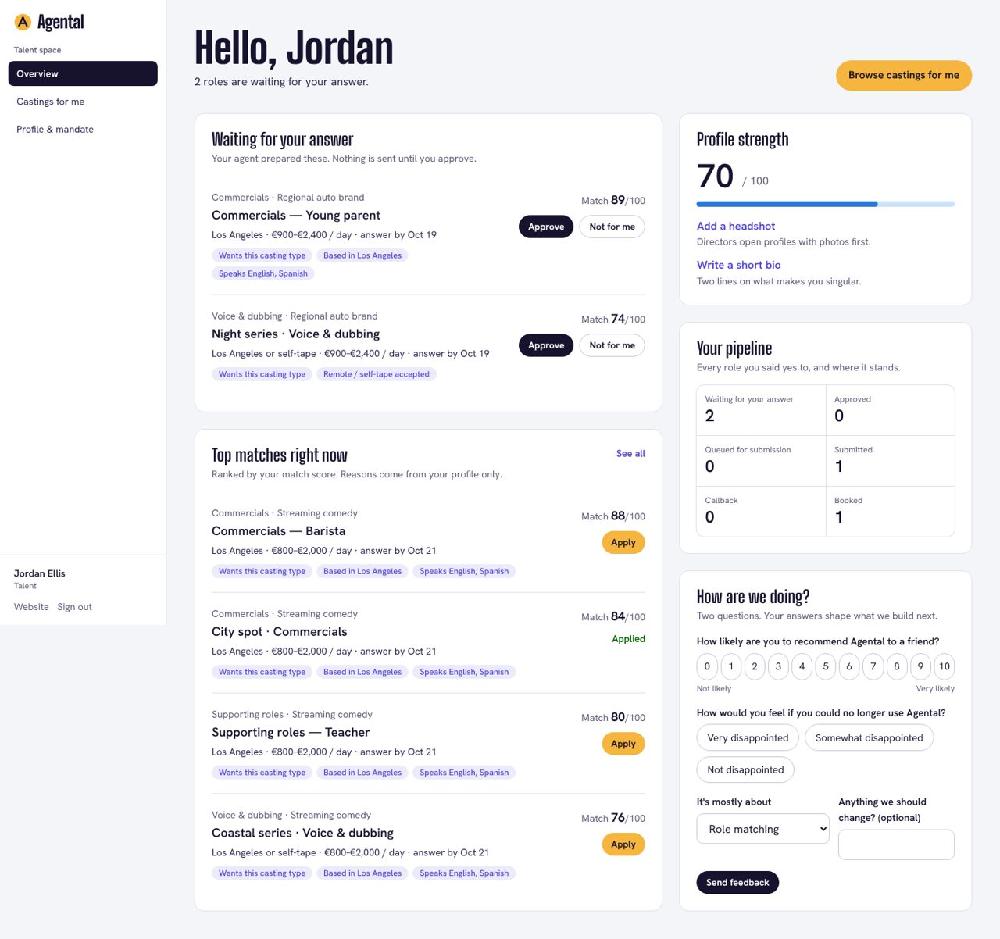
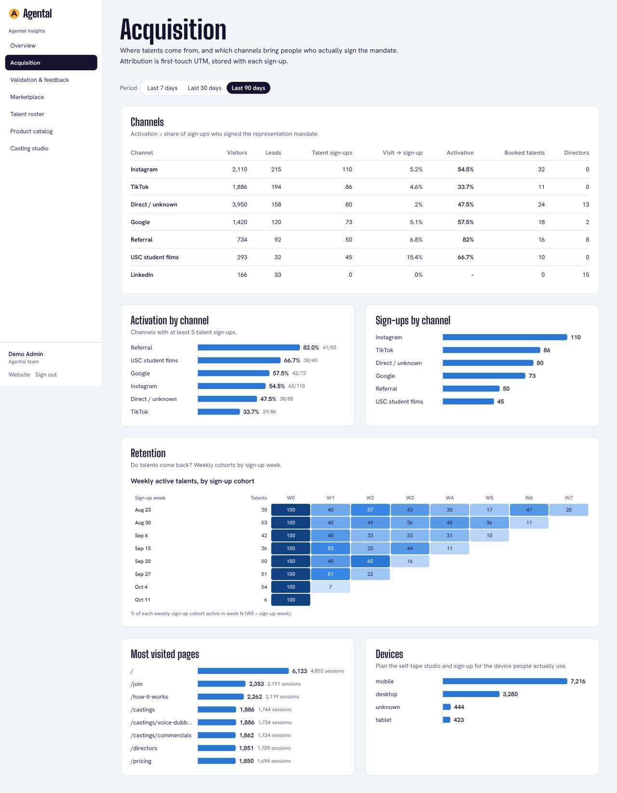

# Agental — web app + Supabase backend

Agental is an artist agency augmented by AI. Talents get a real agent and an AI that watches castings 24/7. Casting directors get ranked shortlists of represented talents who have already said yes.

This repository rebuilds the public site at agental.co/en/talents from scratch, with clearer navigation, and adds the parts the original doesn't have:

- **Registration** for talents and casting directors. The data is written straight into Postgres by a database trigger.
- **A talent space**: role proposals to approve or decline, ranked castings, profile and headshot, the mandate, data export and feedback.
- **A casting studio**: post a casting, get explainable ranked matches, propose talents, then call back, book or pass.
- **Insights** for the Agental team: validation, acquisition, retention, the marketplace balance, a fairness check on how opportunities are spread, and SQL-generated "what to do next" guidance. There is also a live activity feed and a product catalog that edits the website without a deploy.



| Insights overview | Marketplace |
|---|---|
|  |  |

| Talent space | Acquisition & retention |
|---|---|
|  |  |

> **Demo data.** Every person, company, comment and number in the seeded database is synthetic (120 days of sample data, emails on `example.com`). Use the seed for demos only, never in production.

---

## Stack

| Layer | Choice | Why |
|---|---|---|
| Web | Next.js 16 (App Router, Server Actions, `proxy.ts`), React 19, TypeScript, Tailwind CSS 4 | Server-rendered member areas; public pages use ISR |
| Data | Supabase Postgres + RLS | One source of truth. Security sits in the database, not just the UI |
| Auth | Supabase Auth (email + password), `@supabase/ssr` cookies | Session refreshed in `src/proxy.ts`, verified in `src/lib/auth.ts` |
| Files | Supabase Storage, private `headshots` bucket | Upload straight from the browser, one folder per user |
| Live | Supabase Realtime (`postgres_changes`) | Live activity feed on `/insights` |
| Jobs | `pg_cron` | Nightly KPI snapshots, closing expired castings |
| Analytics | First-party `events` table + 11 SQL functions | No third-party tracker. The funnel joins visits to real sign-ups |
| Validation | Zod on every Server Action, plus CHECK constraints in SQL | Two layers of validation |

---

## Quick start

```bash
npm install
cp .env.example .env.local      # fill in your Supabase URL + publishable key
npm run dev                     # http://localhost:3000
```

If you leave the environment variables empty, the marketing pages still render with built-in catalog data. Member areas need Supabase.

### Set up Supabase (new project)

1. Create a project, then install the CLI: `npm i -g supabase`.
2. In this folder, run `supabase init` (it keeps the existing `supabase/migrations`), then `supabase link --project-ref <ref>`.
3. Run `npm run db:push`. This applies the 6 migrations: schema, RLS, analytics, catalog, cron jobs and indexes.
4. Optional demo data: `SUPABASE_DB_URL=<connection string> npm run db:seed`. To set the demo password first, run `psql "$SUPABASE_DB_URL" -c "alter database postgres set agental.demo_password = '<pick one>'"`, or edit the default inside `seed.sql`.
5. Under **Authentication → URL configuration**, set the Site URL and add `http://localhost:3000/auth/callback` plus your production `/auth/callback` to the redirect URLs.
6. Pick one of these for email confirmation:
   - Turn off **Confirm email** for demos. Sign-up then logs people in straight away.
   - Or configure custom SMTP (for example Resend). The built-in mailer is rate-limited and only meant for testing.
7. To give someone admin access, run `insert into public.admin_allowlist (email) values ('you@yourdomain.com');` **before** they sign up. Roles are never taken from the client.
8. After any schema change, run `npm run db:types` to regenerate the TypeScript types.

### Deploy

Import the repo in Vercel and set the three `NEXT_PUBLIC_*` variables. That's all. **Never** add the service-role/secret key to this app: every query runs as the signed-in user, so RLS applies.

---

## Routes

| Area | Path | What it does |
|---|---|---|
| Site | `/`, `/how-it-works`, `/castings`, `/castings/[slug]`, `/pricing`, `/faq`, `/about` | Talent-facing site. Plans and casting types are read from the database |
| Site | `/directors` | Casting-director landing page and brief form (stored as a director lead) |
| Auth | `/join` (`?role=director`, `?plan=`, `?interest=`), `/login`, `/auth/callback`, `/auth/signout` | Multi-step registration that captures attribution |
| Talent | `/app`, `/app/castings`, `/app/profile` | Proposals to approve or decline, ranked castings, profile, headshot, mandate ledger, feedback (NPS + PMF), JSON export |
| Director | `/studio`, `/studio/new`, `/studio/[id]` | Post a casting, ranked matches, propose talents, pipeline actions |
| Team | `/insights` (+ `/acquisition`, `/validation`, `/marketplace`, `/talents`, `/catalog`) | Analytics, roster with CSV export, live catalog editor |
| API | `/api/me/export`, `/api/insights/talents.csv` | Self-service data export; admin CSV export (formula-injection safe) |

Navigation has an audience switch ("For talents" or "For casting directors") that changes the nav set. Signed-in people get a role-aware account menu, and each member area has its own sidebar.

---

## How Supabase is used

### Data model (`supabase/migrations/…_core_schema.sql`)

`profiles` (role) → `talents` / `casting_directors` · `castings` → `applications` → `application_events` (append-only audit) · `consents` (append-only, versioned) · `plans`, `casting_types` (product catalog) · `leads`, `events`, `feedback`, `kpi_snapshots` (acquisition and validation) · `admin_allowlist` (not exposed).

### Business rules in the database (`…_auth_logic_rls.sql`)

- **Sign-up trigger.** `private.handle_new_user` turns the registration metadata into a profile, a talent or director row, consent ledger entries and a lead conversion, plus a `sign_up` event stitched to the visitor's session.
- **Adults only.** `birth_date` must be at least 18 years ago (CHECK constraint).
- **The talent always says yes first.** `private.applications_guard` refuses `queued/submitted/callback/booked/passed` without `approved_at`. It also limits which transitions each role may make: a talent can approve or decline; a director can propose, call back, book or pass.
- **Explainable matching v0.** `private.match_score` applies hard filters first (exclusions, age, gender only if the brief states it, required languages). It then computes a 0–100 score with plain-language reasons. It never infers traits from photos.
- **RPCs.** `recommended_castings` (talent), `match_talents`, `propose_talents` and `casting_pipeline` (director/admin; they return only shareable fields, and declined talents stay anonymous).
- **Computed field.** `completeness(talents)`, used as `select('*, completeness')`.

### Row Level Security (summary)

| Table | anon | talent | director | admin |
|---|---|---|---|---|
| plans, casting_types | read active | read active | read active | all |
| castings | read open | read open | read open + own; create/update own | all |
| talents | – | read/update own (safe columns) | – (via RPC only) | read/update |
| applications | – | read own; apply (= approve); approve/decline | read/update on own castings | all |
| consents | – | read/insert own (no update/delete) | read/insert own | read |
| leads, events | insert only | insert only | insert only | read |
| feedback | – | insert/read own | insert/read own | read |
| storage `headshots` | – | own folder | – | read |

Column privileges stop users from changing their role, verification status or attribution.

### Analytics layer (`…_analytics.sql`)

All of these are `SECURITY INVOKER`, admin-checked, and return JSON:

| Function | Question it answers | Page |
|---|---|---|
| `analytics_overview(days)` | How are we doing vs the previous period? | Overview |
| `analytics_timeseries(days)` | Daily traffic, sign-ups, mandates, bookings | Overview |
| `analytics_funnel(days)` | Where do people drop between visit and first booking? | Overview |
| `analytics_acquisition(days)` | Which channels bring people who actually activate? | Acquisition |
| `analytics_cohorts(weeks)` | Do talents come back week after week? | Acquisition |
| `analytics_validation(days)` | Is demand real before revenue? (waitlist, interest by type, plan clicks, director briefs) | Validation |
| `analytics_feedback(days)` | NPS, Sean Ellis PMF, weakest topics, verbatims | Validation |
| `analytics_supply_demand()` | Supply vs demand per casting type and city | Marketplace |
| `analytics_pipeline(days)` | Response time, callback rate, match-score calibration, opportunity fairness (top-10% share, Gini) | Marketplace |
| `analytics_onboarding()` | Where talents get stuck and which fields are missing | Marketplace |
| `analytics_insights()` | Rule-based next actions, each with its evidence | Overview |

Because the numbers come from SQL, the same functions can feed Ship Fund updates, n8n reports or a notebook (`select public.analytics_overview(30)` as an admin).

### Jobs (`…_catalog_and_jobs.sql`)

`pg_cron` runs `private.snapshot_kpis()` daily (06:55 UTC) and `private.close_expired_castings()` (07:05 UTC).

---

## Project structure

```
src/
  app/
    (site)/            public pages + directors brief form
    (auth)/            join wizard, login
    app/               talent space
    studio/            casting-director studio
    insights/          team analytics + catalog editor
    actions/           Server Actions (auth, talent, studio, catalog, leads), Zod-validated
    api/               data export endpoints
    auth/              email callback, sign-out
  components/          site chrome, app shell, charts (SVG, no chart lib), forms
  lib/
    supabase/          server/browser clients, env, generated types
    auth.ts            data access layer (verified user + role)
    analytics.ts       typed wrappers for the SQL analytics functions
    tracking.ts        first-party event tracker + first-touch attribution
  proxy.ts             session refresh + optimistic route protection
supabase/
  migrations/          6 ordered migrations
  seed.sql             120 days of synthetic demo data (4 blocks)
```

---

## Security notes

- The three `SECURITY DEFINER` RPCs that directors call (`match_talents`, `propose_talents`, `casting_pipeline`) check casting ownership inside the function. The Supabase advisor flags them as "signed-in users can execute"; that is intentional, because directors must not read the talents table directly.
- `admin_allowlist` has RLS on and no policies, so it is invisible to the API.
- Turn on **leaked password protection** in Auth settings (advisor warning).
- Seeded demo accounts share one password. Change it, or delete those users, before showing the project publicly.

## Known limitations and next steps

- Matching is rule-based (v0). The planned next step is pgvector similarity plus an LLM rerank on the top 20, with the same explanations and a monthly fairness check.
- No payments. Paid plans are displayed to measure interest only. Charging represented talents is regulated in California (Labor Code §1700.40, §1702), so keep paid tiers paused until counsel signs off. Toggle them in `/insights/catalog`.
- Email goes through Supabase's mailer. Connect Resend (SMTP) before real users join.
- Submission to external casting platforms (n8n workflows) is out of scope here. The `applications` states and audit trail are ready for it.
- Children and teens are intentionally excluded in V1.
